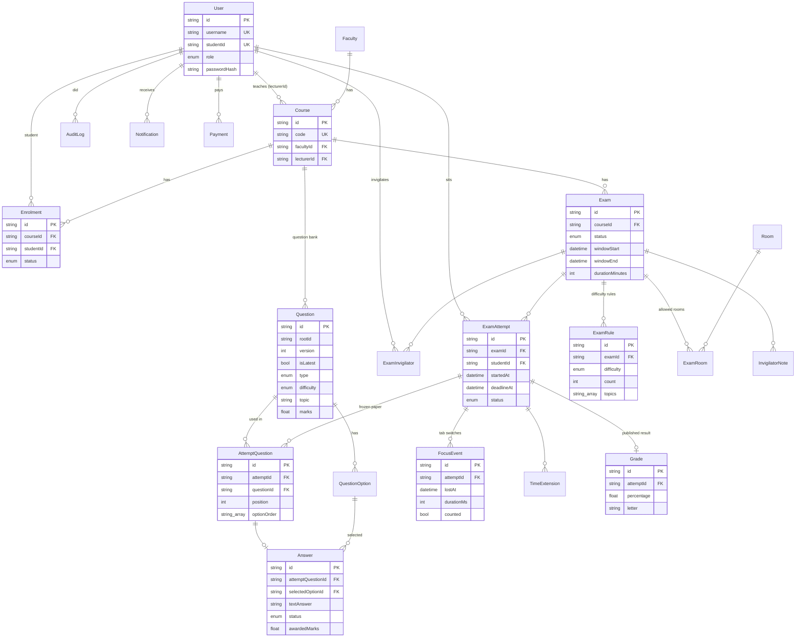

# Database design

PostgreSQL (Supabase), managed with Prisma. The schema is in `backend/prisma/schema.prisma`; versioned migrations are in `backend/prisma/migrations/`. There are 22 tables, each with a primary key, linked by foreign keys.

## Tables

| Table | Purpose |
|---|---|
| `User` | Every account. `role` = ADMIN, LECTURER, STUDENT or INVIGILATOR. bcrypt `passwordHash`. `studentId` is unique. |
| `Faculty`, `Course` | Faculties and courses (code, name, semester, lecturer). |
| `Enrolment` | Student ↔ course. Dropping sets `status = DROPPED`; the row is kept, so past results stay. Unique per (course, student). |
| `Room` | Exam rooms with the lab's IPv4 network (CIDR), used to restrict where exams can be started. |
| `Question`, `QuestionOption` | The question bank. **Versioning:** editing a question already used in an attempt creates a new row with the same `rootId`, `version + 1` and `isLatest = true`. Old attempts keep pointing to the old row. |
| `Exam`, `ExamRule` | Exam settings and rules such as "10 EASY from topics X, Y". |
| `ExamRoom`, `ExamInvigilator` | Allowed rooms and assigned invigilators (many-to-many). |
| `ExamAttempt` | One student's sitting. `startedAt` and `deadlineAt` are **server** times. Unique per (exam, student), which is what makes resume safe. |
| `AttemptQuestion` | The personal paper, frozen at start: which question version, in which position, and the option order. |
| `Answer` | Saved answer, grading status (`AUTO_GRADED`, `NEEDS_REVIEW`, `MANUALLY_GRADED`), marks, rubric scores and comment. |
| `FocusEvent` | Each tab switch: lost/regained time, duration, and whether it is counted (≥ 1 s). |
| `TimeExtension`, `InvigilatorNote` | Invigilator actions (extensions are capped at 15 minutes per student). |
| `GradeScale`, `Grade` | The university letter scale, and the published result per attempt. |
| `AuditLog` | Who did what, and when, for sensitive actions. |
| `Notification`, `SmsOutbox`, `Payment` | In-app messages (English and Somali), the simulated SMS outbox, and simulated mobile-money payments. |
